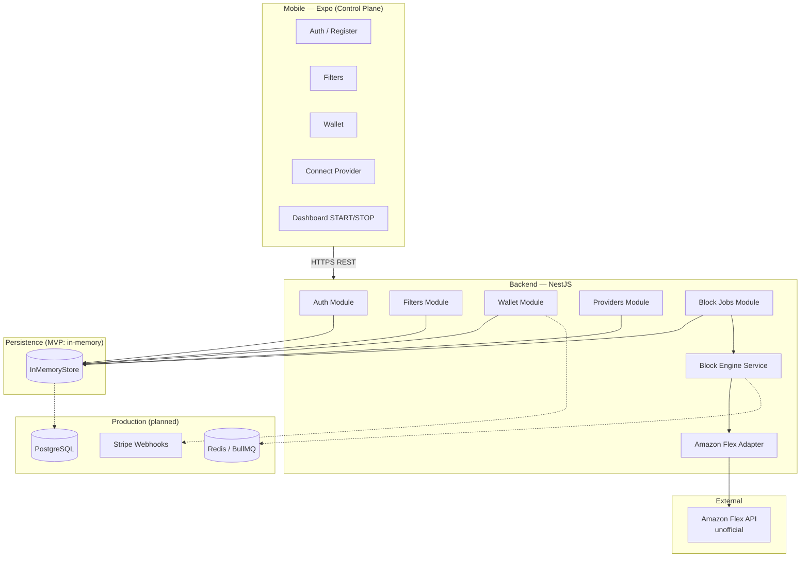
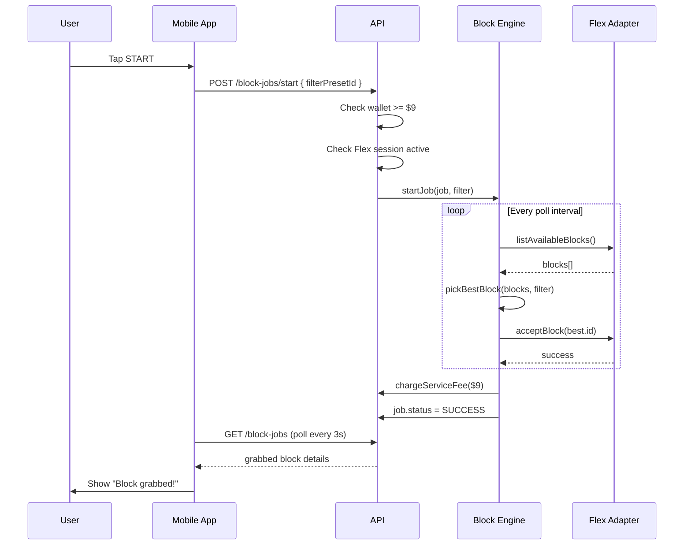

# ⚡Thunder ⚡

**Thunder** is a cross-platform mobile app (iOS + Android) that helps delivery drivers automatically find and grab the best matching delivery blocks based on their preferences. Users connect a delivery provider (Amazon Flex first), configure filters, fund an in-app wallet, and tap **START** — a server-side block engine polls provider APIs and reserves matching blocks on their behalf.

> **Business model:** Block earnings (e.g. $250) are paid by the provider directly to the driver. Thunder charges a separate **$9 service fee** per successful grab from the in-app wallet.

| | |
|---|---|
| **Platform** | React Native + Expo SDK 54 (iOS & Android) |
| **Backend** | NestJS (TypeScript) |
| **Primary provider (v1)** | Amazon Flex |
| **Repo layout** | npm workspaces monorepo |
| **MVP status** | Functional end-to-end with **stubbed** payments & provider API |

---

## Table of contents 🌿

1. [Problem & solution](#problem--solution)
2. [System architecture](#system-architecture)
3. [Control plane vs data plane](#control-plane-vs-data-plane)
4. [Repository structure](#repository-structure)
5. [Backend modules](#backend-modules)
6. [Mobile app](#mobile-app)
7. [Shared packages](#shared-packages)
8. [Core user flows](#core-user-flows)
9. [Data model](#data-model)
10. [API reference](#api-reference)
11. [Block engine & provider adapter](#block-engine--provider-adapter)
12. [Wallet & billing](#wallet--billing)
13. [MVP vs production](#mvp-vs-production)
14. [Development setup](#development-setup)
15. [Environment variables](#environment-variables)
16. [Troubleshooting](#troubleshooting)
17. [Roadmap](#roadmap)
18. [Further reading](#further-reading)

---

## Problem & solution

Delivery platforms like **Amazon Flex** publish time-limited delivery blocks (shift slots with wage, duration, warehouse location). Hundreds of drivers compete for the same blocks; the fastest reservation wins.

**Thunder** automates this process:

1. User sets filters (dates, times, locations, minimum wage).
2. User connects their Flex account and funds a wallet.
3. User taps **START**.
4. A **server-side block engine** polls the provider API at high frequency (~50–100 ms target), scores available blocks, and accepts the best match.
5. On success, Thunder charges the service fee and notifies the user.

### Why polling cannot run on the phone

| Platform | Background limit | Implication |
|----------|------------------|-------------|
| **iOS** | BGTaskScheduler: ~15 min minimum interval, ~30 s max runtime | Cannot sustain millisecond polling on-device |
| **Android** | WorkManager / foreground service — better, but still unreliable vs server | Same conclusion for v1 |
| **Server** | Sub-100 ms polling, 24/7, geo-distributed workers | **Block engine must run server-side** |

The mobile app is the **control plane** (UI, auth, filters, wallet, start/stop). The backend is the **data plane** (polling, scoring, grabbing).

---

## System architecture



### Layer responsibilities

| Layer | Technology | Responsibility |
|-------|------------|----------------|
| **Mobile** | Expo SDK 54, React Native, expo-router | User interface, secure token storage, API client |
| **API Gateway** | NestJS | REST endpoints, auth guards, orchestration |
| **Block Engine** | NestJS service (future: BullMQ worker) | Poll loop, block scoring, accept, fee charge |
| **Provider Adapter** | `IProviderAdapter` interface | Provider-specific API calls (Amazon Flex v1) |
| **Shared** | TypeScript + Zod | Types, validation, constants shared across apps |
| **Store** | InMemoryStore (MVP) → PostgreSQL (prod) | Users, wallets, filters, jobs, sessions |

---

## Control plane vs data plane

```
┌──────────────────────────────────────────────────────────────┐
│  CONTROL PLANE — Mobile App (Thunder)                        │
│  • Register / login                                          │
│  • Configure filter presets                                  │
│  • Recharge wallet                                           │
│  • Connect Amazon Flex (session token relay)                 │
│  • START / STOP block search                                 │
│  • Receive push notifications (planned)                      │
└────────────────────────────┬─────────────────────────────────┘
                             │ HTTPS  /api/v1/*
                             ▼
┌──────────────────────────────────────────────────────────────┐
│  DATA PLANE — Backend                                        │
│  • Validate wallet balance & provider session                │
│  • Run block engine poll loop (50–100 ms)                    │
│  • Score blocks against user filters                         │
│  • Call provider AcceptOffer API                             │
│  • Charge $9 fee on confirmed grab                           │
│  • Refund on cancelled block                                 │
└────────────────────────────┬─────────────────────────────────┘
                             │
                             ▼
                    Amazon Flex (unofficial API)
```

---

## Repository structure

```
thunder-spark-flex/                 # npm workspaces root
├── apps/
│   ├── api/                        # NestJS REST API + block engine
│   │   └── src/
│   │       ├── main.ts             # Entry, CORS, global prefix /api/v1
│   │       ├── app.module.ts       # Root module wiring
│   │       ├── common/             # AuthGuard, ApiResponse helpers
│   │       ├── store/              # InMemoryStore (MVP persistence)
│   │       └── modules/
│   │           ├── auth/           # Register, login, JWT
│   │           ├── filters/        # Filter preset CRUD
│   │           ├── wallet/         # Balance, recharge, charge, refund
│   │           ├── providers/      # Connect delivery providers
│   │           ├── block-jobs/     # Start/stop job lifecycle
│   │           ├── block-engine/   # Poll loop + AmazonFlexAdapter
│   │           └── health/         # Health check
│   │
│   └── mobile/                     # Expo React Native app
│       ├── app/                    # expo-router file-based routes
│       │   ├── (auth)/             # login, register
│       │   └── (tabs)/             # dashboard, filters, wallet, provider
│       ├── components/ui.tsx       # Button, Card, Input, Badge
│       ├── constants/theme.ts      # Yellow Thunder design tokens
│       ├── context/auth-context.tsx
│       └── lib/
│           ├── api.ts              # HTTP client + API_URL resolution
│           └── auth-storage.ts     # expo-secure-store session
│
├── packages/
│   ├── shared/                     # @thunder-spark/shared
│   │   └── src/                    # types, Zod schemas, constants, errors
│   └── provider-core/              # @thunder-spark/provider-core
│       └── src/                    # IProviderAdapter, block scoring
│
└── docs/
    ├── SYSTEM_DESIGN.md            # Detailed design spec
    └── EXTERNAL_SETUP.md           # Stripe, hosting, App Store, Flex API
```

---

## Backend modules

All API routes are prefixed with **`/api/v1`**.

| Module | Path | Auth | Description |
|--------|------|------|-------------|
| **health** | `GET /health` | No | Service health check |
| **auth** | `POST /auth/register`, `POST /auth/login` | No | User accounts, JWT access + refresh tokens |
| **filters** | `GET/POST/PUT/DELETE /filters` | Yes | Filter presets (dates, times, locations, min wage) |
| **wallet** | `GET /wallet`, `POST /wallet/recharge` | Yes | Balance, transactions, recharge (stub in MVP) |
| **providers** | `GET /providers`, `POST /providers/connect` | Yes | Link Amazon Flex session (stub in MVP) |
| **block-jobs** | `GET/POST /block-jobs/*` | Yes | Start/stop search, status, refund |

### Block engine (`apps/api/src/modules/block-engine/`)

Runs inside the API process for MVP. Each active job:

1. Validates Amazon Flex session is active.
2. Polls `AmazonFlexAdapter.listAvailableBlocks()` on an interval.
3. Scores blocks via `pickBestBlock()` from `@thunder-spark/provider-core`.
4. Calls `acceptBlock()` on the best match.
5. On success: charges `SERVICE_FEE_CENTS` ($9), sets job status to `SUCCESS`.
6. On captcha: pauses job (`PAUSED`).
7. On session expiry: fails job (`FAILED`).

### Auth

- Passwords hashed with **bcrypt** (10 rounds).
- JWT-like tokens (MVP uses HMAC-signed payloads; production should use proper JWT library + refresh rotation).
- Protected routes use `AuthGuard` + `@CurrentUser()` decorator.

---

## Mobile app

Built with **Expo Router** (file-based navigation) and a **yellow + dark** design system (`constants/theme.ts`).

| Screen | Route | Purpose |
|--------|-------|---------|
| Login | `/(auth)/login` | Email/password sign-in |
| Register | `/(auth)/register` | Create Thunder account |
| Dashboard | `/(tabs)/dashboard` | START/STOP, job status, last grab |
| Filters | `/(tabs)/filters` | View/create filter presets |
| Wallet | `/(tabs)/wallet` | Balance, recharge, transaction history |
| Connect | `/(tabs)/provider` | Link Amazon Flex account |

### API connectivity

The mobile app resolves the API base URL in this order:

1. `EXPO_PUBLIC_API_URL` from `apps/mobile/.env`
2. `extra.apiUrl` from `app.config.js`
3. Fallback LAN IP for physical device testing

**Important:** When testing on a physical phone, `localhost` will not work. Set your PC's LAN IP:

```env
EXPO_PUBLIC_API_URL=http://10.x.x.x:3000/api/v1
```

The API listens on `0.0.0.0` so it accepts connections from the local network.

---

## Shared packages

### `@thunder-spark/shared`

Single source of truth for cross-app contracts:

| Export | Purpose |
|--------|---------|
| `constants.ts` | `SERVICE_FEE_CENTS`, `PROVIDERS`, `BLOCK_JOB_STATUS`, `ERROR_CODES` |
| `schemas.ts` | Zod validation for register, login, filters, wallet recharge |
| `types.ts` | `User`, `FilterPreset`, `Wallet`, `BlockJob`, `DeliveryBlock`, etc. |
| `errors.ts` | `AppError` class |

### `@thunder-spark/provider-core`

Provider-agnostic block logic:

```typescript
interface IProviderAdapter {
  readonly providerId: string;
  validateSession(connection: ProviderConnection): Promise<boolean>;
  listAvailableBlocks(connection: ProviderConnection): Promise<DeliveryBlock[]>;
  acceptBlock(connection: ProviderConnection, blockId: string): Promise<AcceptResult>;
}

// Scoring: wage + date match + location match + time range + min wage bonus
pickBestBlock(blocks: DeliveryBlock[], filter: FilterPreset): DeliveryBlock | null
```

Production will add `packages/provider-amazon-flex` with real reverse-engineered endpoints.

---

## Core user flows

### Start block search



### Wallet recharge (MVP stub)

```
User taps +$50 → POST /wallet/recharge { amountCents: 5000 }
→ Wallet balance credited instantly (no Stripe in MVP)
```

### Refund on cancel

```
User cancels grabbed block → POST /block-jobs/:id/refund
→ wallet.refund() credits $9 back
→ grabbedBlock.status = CANCELLED
```

---

## Data model

| Entity | Key fields | Notes |
|--------|------------|-------|
| **User** | `id`, `email`, `name`, `passwordHash` | Thunder account (not Flex account) |
| **ProviderConnection** | `userId`, `provider`, `status`, `expiresAt` | Flex session; encrypted in production |
| **FilterPreset** | `dates[]`, `timeRanges[]`, `locations[]`, `minWageCents` | User search criteria |
| **Wallet** | `userId`, `balanceCents`, `currency` | Prepaid balance for service fees |
| **WalletTransaction** | `type`, `amountCents`, `referenceType`, `referenceId` | CREDIT / DEBIT / REFUND / HOLD / RELEASE |
| **BlockJob** | `status`, `filterPresetId`, `pollCount`, `grabbedBlock` | RUNNING → SUCCESS / FAILED / STOPPED / PAUSED |
| **GrabbedBlock** | `wageCents`, `locationName`, `feeChargedCents`, `status` | ACTIVE / CANCELLED / COMPLETED |

---

## API reference

Base URL: `http://localhost:3000/api/v1` (dev)

### Public

| Method | Path | Body | Response |
|--------|------|------|----------|
| `GET` | `/health` | — | `{ status, service, version }` |
| `POST` | `/auth/register` | `{ email, password, name }` | `{ user, tokens }` |
| `POST` | `/auth/login` | `{ email, password }` | `{ user, tokens }` |

### Authenticated (header: `Authorization: Bearer <token>`)

| Method | Path | Body | Response |
|--------|------|------|----------|
| `GET` | `/filters` | — | `FilterPreset[]` |
| `POST` | `/filters` | `FilterPresetInput` | `FilterPreset` |
| `PUT` | `/filters/:id` | `FilterPresetInput` | `FilterPreset` |
| `DELETE` | `/filters/:id` | — | `{ deleted: true }` |
| `GET` | `/wallet` | — | `{ wallet, transactions }` |
| `POST` | `/wallet/recharge` | `{ amountCents }` | `{ wallet, transaction }` |
| `GET` | `/providers` | — | `ProviderConnection[]` |
| `POST` | `/providers/connect` | `{ provider, sessionPayload }` | `ProviderConnection` |
| `GET` | `/block-jobs` | — | `BlockJob[]` |
| `GET` | `/block-jobs/:id` | — | `BlockJob` |
| `POST` | `/block-jobs/start` | `{ filterPresetId }` | `BlockJob` |
| `POST` | `/block-jobs/:id/stop` | — | `BlockJob` |
| `POST` | `/block-jobs/:id/refund` | — | `BlockJob` |

All responses use the envelope:

```typescript
// Success
{ success: true, data: T }

// Error
{ success: false, error: { code: string, message: string } }
```

---

## Block engine & provider adapter

### Scoring algorithm (`packages/provider-core`)

Blocks are ranked by a weighted score:

| Factor | Points |
|--------|--------|
| Base | `wageCents` |
| Date matches filter | +5000 |
| Location matches filter | +3000 |
| Time within range | +2000 |
| Meets minimum wage | +1000 |

### Amazon Flex integration (production plan)

Amazon Flex has **no public API**. Production integration requires:

1. Secure WebView login in mobile app to capture session tokens.
2. Encrypted storage of tokens on the server (AES-256-GCM).
3. Reverse-engineered REST calls (`GetOffersForProvider`, `AcceptOffer`, etc.).
4. Human-like polling jitter (50–150 ms) to reduce ban risk.
5. Captcha pause + user notification flow.

> **Compliance:** Automating Amazon Flex may violate Amazon's Terms of Service. Legal review and in-app risk disclosure are required before production launch.

---

## Wallet & billing

| Event | Wallet | Notes |
|-------|--------|-------|
| Recharge $50 | +5000 cents | MVP: instant stub; prod: Stripe webhook |
| Successful grab | −900 cents ($9) | Charged only on confirmed accept |
| Cancelled block refund | +900 cents | Via `POST /block-jobs/:id/refund` |

Constants (from `@thunder-spark/shared`):

- `SERVICE_FEE_CENTS = 900` ($9 per grab)
- `MIN_WALLET_BALANCE_CENTS = 900` (minimum to start)

Block earnings from Amazon go **directly to the driver** — Thunder never touches provider payouts.

---

## MVP vs production

| Feature | MVP (current) | Production (planned) |
|---------|---------------|----------------------|
| Persistence | In-memory (`InMemoryStore`) | PostgreSQL + Prisma |
| Wallet recharge | Instant credit stub | Stripe PaymentSheet + webhooks |
| Amazon Flex | Simulated blocks | Real reverse-engineered API |
| Block engine | In-process `setInterval` | BullMQ worker + Redis |
| Auth tokens | HMAC dev tokens | Proper JWT + refresh rotation |
| Push notifications | — | Expo Notifications + APNs/FCM |
| Deployment | Local dev | Railway/Render + EAS Build |

---

## Development setup

### Prerequisites

- **Node.js** ≥ 20
- **npm** (workspaces)
- For phone testing: **Expo Go** (SDK 54) on same Wi-Fi as dev machine

### Install & run

```powershell
# Clone and install
npm install --legacy-peer-deps

# Build shared packages (required before API starts)
npm run build -w @thunder-spark/shared
npm run build -w @thunder-spark/provider-core

# Terminal 1 — API
npm run dev:api

# Terminal 2 — Mobile
npm run dev:mobile
```

### Testing options

| Method | Platform | Notes |
|--------|----------|-------|
| **Expo Go (QR scan)** | iOS / Android phone | Set `EXPO_PUBLIC_API_URL` to PC LAN IP |
| **Web (`w`)** | Browser | API can stay on `localhost` |
| **iOS simulator (`i`)** | macOS only | Requires Xcode |
| **Android emulator (`a`)** | Any | Requires Android Studio + `ANDROID_HOME` |

### Manual E2E test flow

1. Register a new account on mobile.
2. **Connect** tab → Connect Amazon Flex (stub).
3. **Filters** tab → Create a filter preset.
4. **Wallet** tab → Recharge $50 (stub).
5. **Home** tab → Select filter → **START SEARCH**.
6. Within a few seconds, a simulated block is grabbed and $9 is deducted.

---

## Environment variables

### `apps/mobile/.env`

```env
EXPO_PUBLIC_API_URL=http://YOUR_PC_LAN_IP:3000/api/v1
```

Copy from `apps/mobile/.env.example`.

### `apps/api/.env` (optional for MVP)

```env
PORT=3000
JWT_ACCESS_SECRET=change-me
JWT_REFRESH_SECRET=change-me-too
```

See `apps/api/.env.example` for production variables (PostgreSQL, Redis, Stripe).

---

## Troubleshooting

### `Cannot find module 'babel-preset-expo'`

Ensure it is installed in the mobile workspace:

```powershell
cd apps/mobile
npx expo install babel-preset-expo
```

Then restart Metro (`npm run dev:mobile`).

### Expo Go SDK mismatch

Project uses **Expo SDK 54**. Your Expo Go app must also be SDK 54. Do not downgrade the project — upgrade Expo Go instead.

### `Cannot reach API` on phone

1. API must be running (`npm run dev:api`).
2. Phone and PC on same Wi-Fi.
3. Set `EXPO_PUBLIC_API_URL` to your PC's IPv4 (run `ipconfig` on Windows).
4. Allow Node through Windows Firewall if prompted.

### Port 8081 already in use

Metro will offer port 8082 — accept it. QR code updates automatically.

### Expo login prompt

Choose **Proceed anonymously** for local development. Expo account is only required for EAS Build / publishing.

---

## Roadmap

| Phase | Deliverable | Status |
|-------|-------------|--------|
| 0 | Monorepo + shared types | Done |
| 1 | API + auth + mobile shell | Done |
| 2 | Filters, wallet, provider, block engine (stub) | Done |
| 3 | PostgreSQL + Prisma | Planned |
| 4 | Stripe wallet recharge | Planned |
| 5 | Real Amazon Flex adapter | Planned |
| 6 | WebSocket live status + push notifications | Planned |
| 7 | EAS Build → TestFlight / Play Store | Planned |
| 8 | Additional providers (Uber, Zomato) | Future |

---

## Further reading

| Document | Description |
|----------|-------------|
| [docs/SYSTEM_DESIGN.md](docs/SYSTEM_DESIGN.md) | Full system design spec — NFRs, deployment topology, anti-ban strategy |
| [docs/EXTERNAL_SETUP.md](docs/EXTERNAL_SETUP.md) | External services checklist — Stripe, hosting, App Store, Amazon Flex R&D |
| [prod-requirements.md](prod-requirements.md) | **Fill-in checklist** for hosted production setup (Neon, Render, Dodo Payments) |
| [app_details.txt](app_details.txt) | Original product requirements |

---

## License

Private — all rights reserved.
